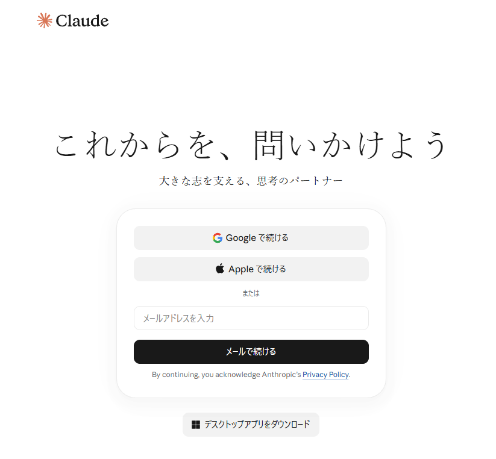
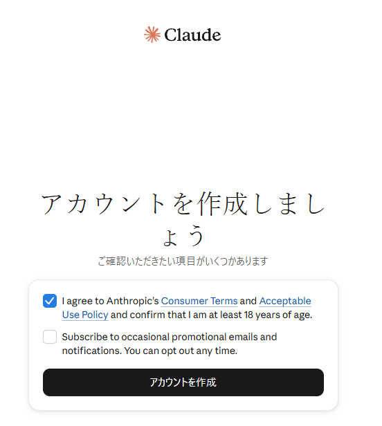
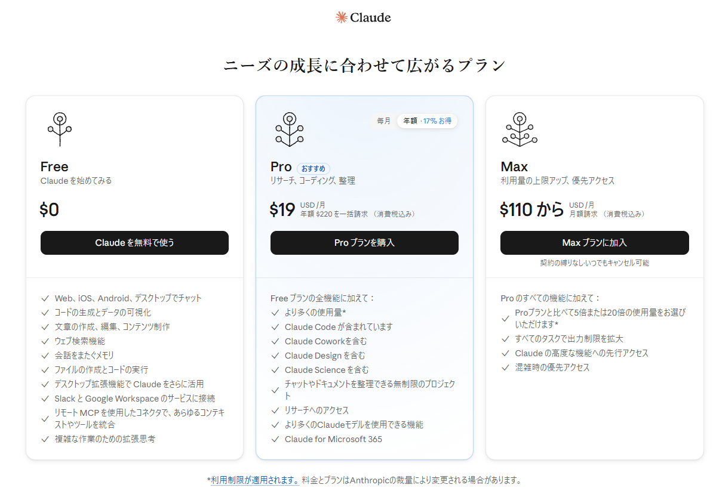
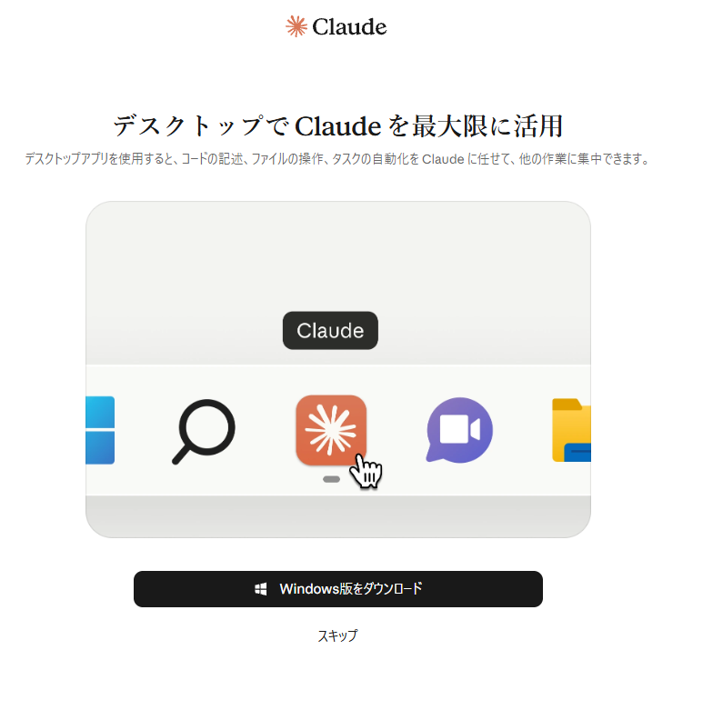
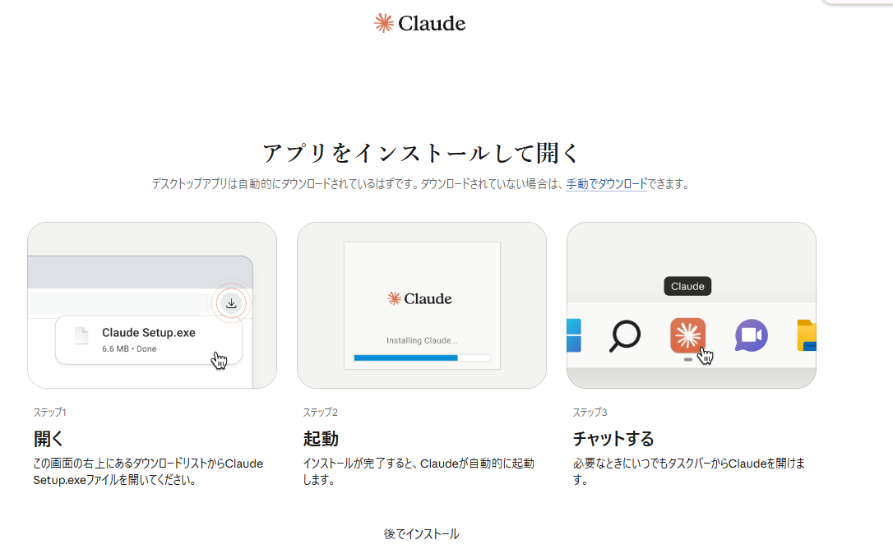
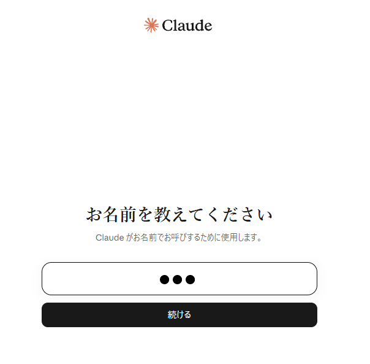
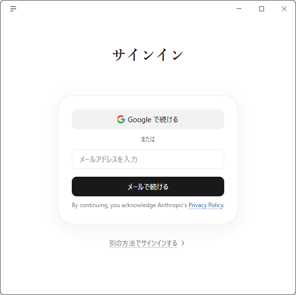
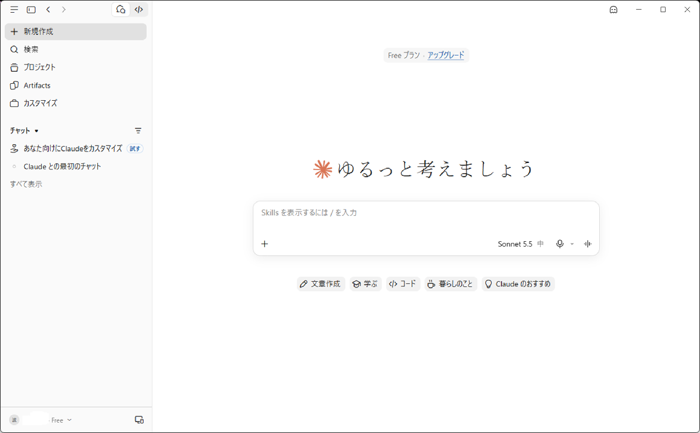
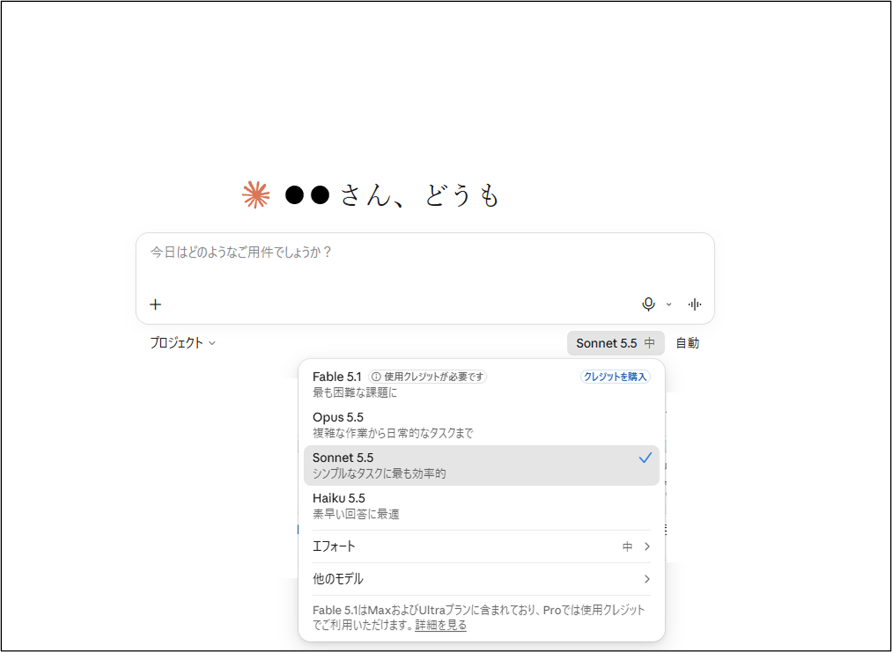

# Claude 開始手順

`環境構築.xlsx` の「Claude」シートを Markdown にしたものです。画像は `images` フォルダにあります。

**講義の前に済ませてください。** 登録に電話番号の認証が必要になることがあり、講義の当日には間に合わない場合があります。

## 1. Web 版

Claude 公式サイトにアクセスします。

- ログイン画面: https://claude.ai/login

アカウントを作成します(利用規約への同意にチェックを入れて「アカウントを作成」)。

プランの選択画面です。研修では **Free**(「Claude を無料で使う」)を選びます。

デスクトップアプリの案内が出ます。Web 版だけで使う場合は「スキップ」します。

初回チャットの前の確認画面です。内容を確認して「続ける」を押します。

名前を入力して「続ける」を押します。

## 2. Claude デスクトップ

Google アカウントでサインインする場合は、アカウントを選択します。

サインインすると、チャットの開始画面になります。

## 3. モデルの選択

チャットの入力欄の右下にあるモデル名(下の画面では「Sonnet 5.5」)をクリックすると、使うモデルを選べます。

| モデル | 画面の説明 | 備考 |
|---|---|---|
| Fable 5.1 | 最も困難な課題に | 使用クレジットが必要です(Max / Ultra プランに含まれ、Pro では使用クレジットで利用)。Free では使えません |
| Opus 5.5 | 複雑な作業から日常的なタスクまで | |
| Sonnet 5.5 | シンプルなタスクに最も効率的 | 画面で選択されているモデルです |
| Haiku 5.5 | 素早い回答に最適 | |

- 「エフォート」で、回答にかける思考の深さを選べます(画面では「中」)。
- 「他のモデル」から、上の一覧にないモデルも選べます。
- 本手順は、画面のとおり **Sonnet 5.5・エフォート「中」** を選んだ状態で実施します。
