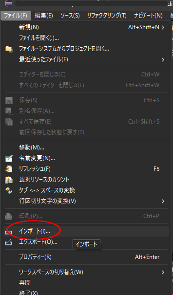
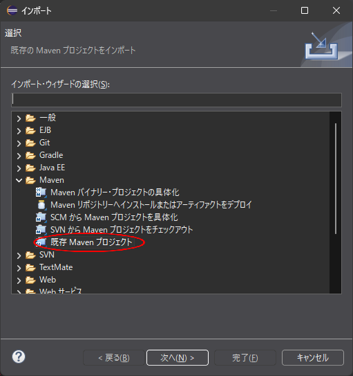
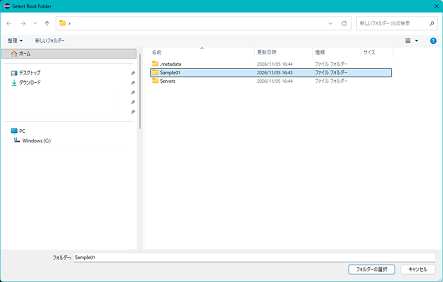
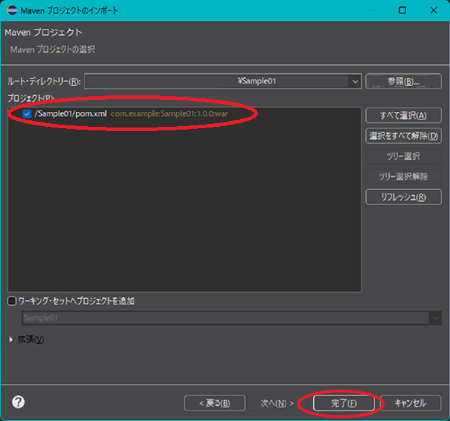
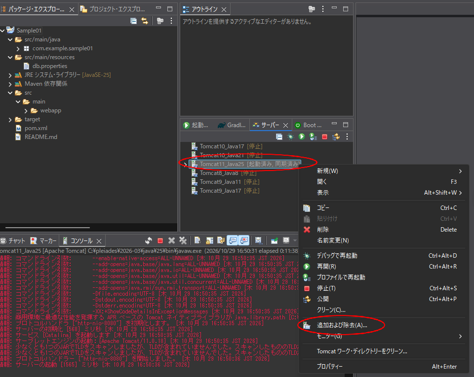
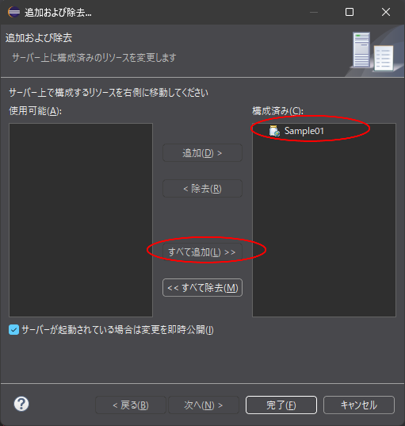
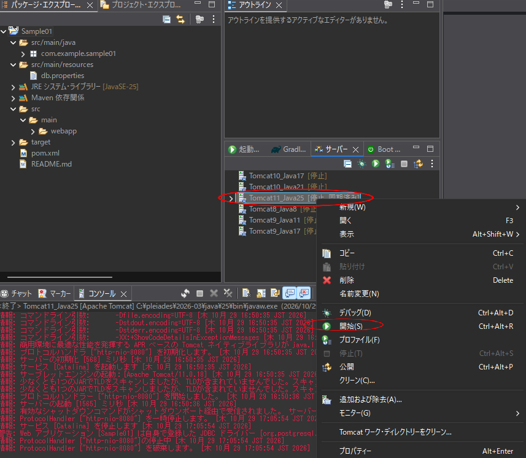

# アプリ実行手順（Java）

Java アプリの生成から動作確認までの手順です。画像は `images` フォルダにあります。

## 起動方法

1. **プログラム用資材をアップロード** する
2. **Claude でプログラミング** する
3. Claude が、作成したプログラムを **zip で圧縮** する
4. ダウンロード後、**解凍** する
5. **Eclipse に Maven で取り込む**(ワークスペース → Sample01 フォルダ)
   - 「ファイル → インポート」を選びます。

   

   - 「Maven」を開き、「既存 Maven プロジェクト」を選んで「次へ」を押します。

   

   - 「参照」を押し、解凍したプロジェクトのフォルダ(Sample01)を選んで「フォルダーの選択」を押します。

   

   - プロジェクトの一覧に `/Sample01/pom.xml` が表示され、チェックが入っていることを確認して「完了」を押します。

   

   - 取り込み後のプロジェクトです。

   
6. **Tomcat を起動** する
   - サーバーを右クリックし、「追加および除去」で Sample01 を右側(構成済み)に移します。

   

   - サーバーを右クリックして起動します。

   
7. **URL にアクセス** する
   - http://localhost:8080/Sample01/

| 項目 | 値 |
|---|---|
| ユーザ名 | `user@example.com` |
| パスワード | `1234` |
