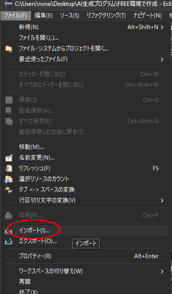
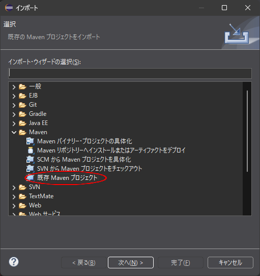
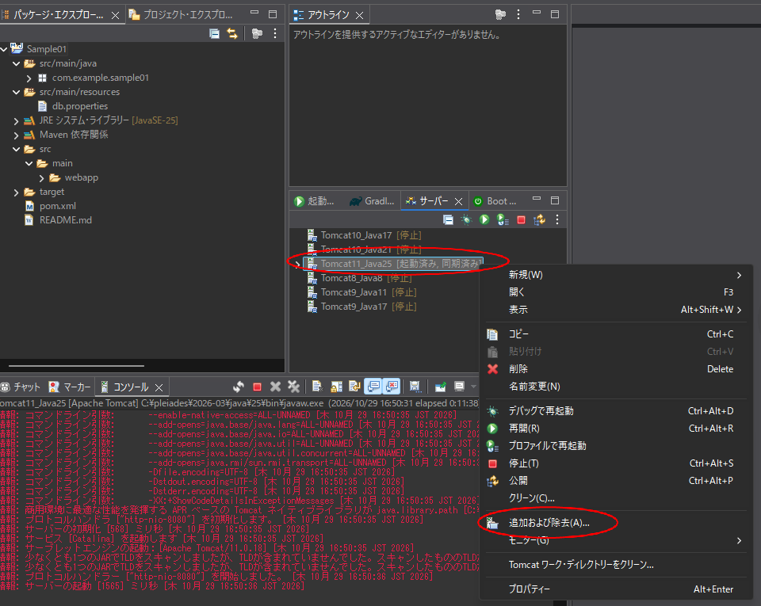
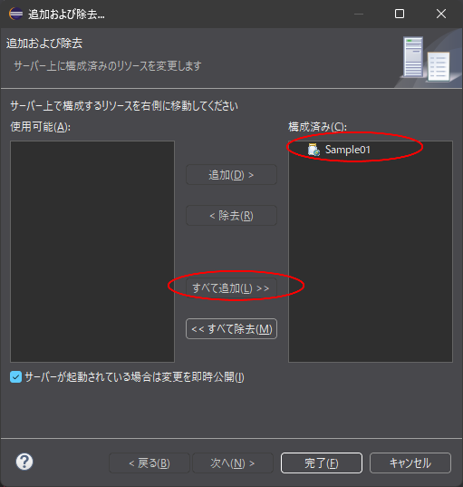
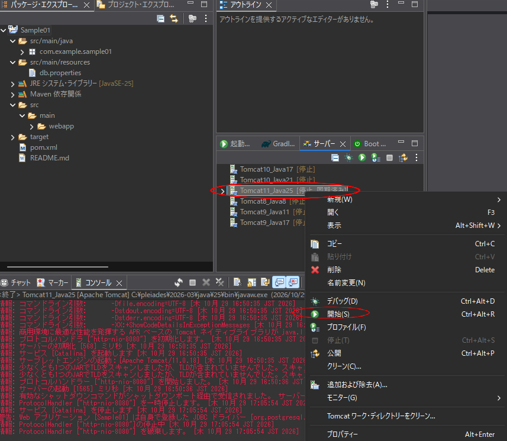

# アプリ実行手順

`環境構築.xlsx` の「Java」「Python」「VBA」シートを Markdown にしたものです。画像は `images` フォルダにあります。

## 1. Java アプリの起動方法

1. **プログラム用資材をアップロード** する
2. **Claude でプログラミング** する
3. Claude が、作成したプログラムを **zip で圧縮** する
4. ダウンロード後、**解凍** する
5. **Eclipse に Maven で取り込む**(ワークスペース → Sample01 フォルダ(親))
   - 「ファイル → インポート」を選びます。

   

   - 「Maven」の「既存 Maven プロジェクト」を選びます。

   

   - 取り込み後のプロジェクトです。

   
6. **Tomcat を起動** する
   - サーバーを右クリックし、「追加および除去」で Sample01 を右側(構成済み)に移します。

   

   - サーバーを右クリックして起動します。

   
7. **URL にアクセス** する
   - http://localhost:8080/Sample01/

| 項目 | 値 |
|---|---|
| ユーザ名 | `user@example.com` |
| パスワード | `1234` |

## 2. Python アプリの起動方法

1. **プログラム用資材をアップロード** する
2. **Claude でプログラミング** する
3. Claude が、作成したプログラムを **zip で圧縮** する
4. ダウンロード後、**解凍** する

### 参考: cmd と PowerShell で使えるコマンドの比較

| やりたいこと | cmd | PowerShell |
|---|---|---|
| ファイルの中身を表示 | `type` | `Get-Content` |
| 環境変数を設定 | `set DB_HOST=localhost` | `$env:DB_HOST="localhost"` |
| venv を有効化 | `venv\Scripts\activate` | `.\venv\Scripts\Activate.ps1` |
| ファイルに書き出す | `> file`(そのまま使える) | `Out-File -Encoding ascii`(`>` は UTF-16 になる) |

以降は cmd で説明します。

### 2-1. 仮想環境の作成

ターミナルを起動し、プロジェクトのディレクトリ(myapp フォルダ)に移動します。

- 初回のみ: 仮想環境を作成する

  ```
  python -m venv venv
  ```

- 毎回実施: 仮想環境を有効化する

  ```
  venv\Scripts\activate.bat
  ```

- 作業終了時に実施: 仮想環境を終了(無効化)する

  ```
  deactivate
  ```

### 2-2. インストール

```
pip install -r requirements.txt
```

### 2-3. 環境変数の設定

```
set DJANGO_SECRET_KEY=local-dev-key-change-me-0123456789
set DB_HOST=localhost
set DB_PORT=5432
set DB_NAME=myappdb
set DB_USER=myapp
set DB_PASSWORD=1234
```

### 2-4. マイグレーション

初回、または環境が変わったときに実行します。

```
python manage.py migrate
```

### 2-5. Django 製の内蔵 Web サーバーを起動

```
python manage.py runserver
```

### 2-6. URL へアクセス

- http://127.0.0.1:8000/

| 項目 | 値 |
|---|---|
| ユーザ名 | `user@example.com` |
| パスワード | `1234` |

### 2-7. requirements.txt の生成

環境を作ったときに実行します。

```
python -m pip freeze > requirements.txt
```

中身の確認:

```
type requirements.txt
```

## 3. VBA アプリの起動方法

1. **プログラム用資材をアップロード** する
2. **Claude でプログラミング** する
3. Claude が、作成したプログラムを **zip で圧縮** する
4. ダウンロード後、**解凍** する
5. 解凍されたファイル内にある **手順書にしたがって** Excel にマクロを組み込む
